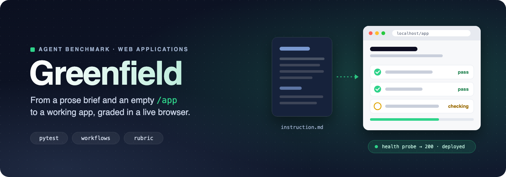
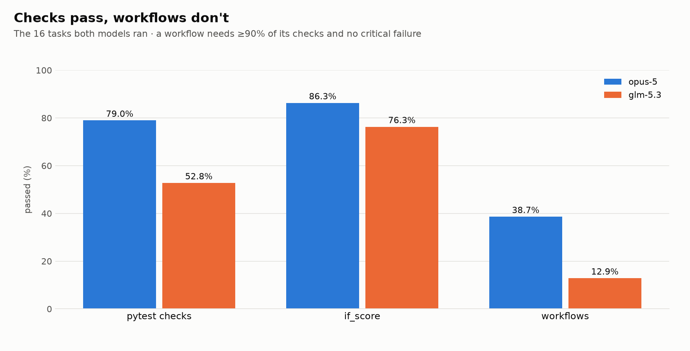
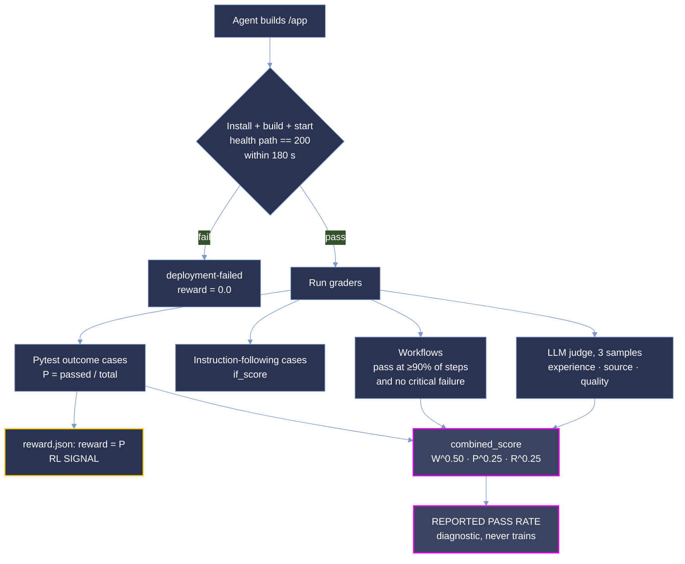

<p align="center">
  <picture>
    <source type="image/svg+xml" srcset="images/hero.svg">
    
  </picture>
</p>

<p align="center">
  <strong>Measuring whether a coding agent can build a working web application from a prose brief alone.</strong>
</p>

<p align="center">
  <a href="#summary"></a>
  <a href="#scoring-methodology"></a>
  <a href="#difficulty-tiers"></a>
</p>

<p align="center"><sub>
  <a href="#summary">Summary</a> · <a href="#repository-layout">Layout</a> · <a href="#difficulty-tiers">Tiers</a> · <a href="#results">Results</a> · <a href="#analysis">Analysis</a> · <a href="#coverage">Coverage</a> · <a href="#dataset-structure">Dataset</a> · <a href="#trajectory-structure">Trajectories</a> · <a href="#scoring-methodology">Scoring</a> · <a href="#running-a-task">Running</a>
</sub></p>

# Greenfield: Application Build Delivery

**Greenfield measures whether a coding agent can turn a prose product brief into a deployed,
working web application that a stranger can drive in a browser.**

Each task hands an agent a long-form product specification, an empty `/app` and a service stack
(PostgreSQL on every task, plus any of Mailpit, MinIO, Kill Bill, Keycloak and PocketBase), and asks it to ship
something that installs, builds, answers a health probe and survives the task's own pytest suite,
workflow checks and an LLM rubric that drives a real browser. There is no repository to patch and no
oracle diff to approximate.

This delivery is **broad and shallow: 25 tasks, 41 graded rollouts.** Every task carries one
`opus-5` run; 16 of the 25 also carry one `glm-5.3` run. With one run per task per model, every
per-task number here is **a single observation, not a rate**, and the two cohorts are only directly
comparable on the 16 tasks they share.

**Not one of the 41 rollouts passed every workflow.** Throughout this document **pass rate is
`combined_score`** from `final_score.json`, as a percentage, averaged over runs where more than one
is pooled:

```
combined_score = workflow^0.50 · pytest^0.25 · rubric^0.25
```

It is a partial-credit, geometric measure: one channel at zero takes the whole product to zero. This
is **not pass@k**.

> **Oracle score disclaimer.** The reference solution is guaranteed a score of 1.0 only on the
> deterministic channels (pytest). Wherever the LLM judge is involved, in the rubric on every task and
> in the workflows of 9 tasks, a perfect oracle score is not guaranteed. See
> [Oracle score](#oracle-score).

## Summary

| Property | Value |
| --- | --- |
| Tasks | 25 |
| Models | `opus-5` (25 runs), `glm-5.3` (16 runs) |
| Runs per task per model | 1 |
| Graded rollouts | 41, all `judge = "scored"` |
| Languages | TypeScript (18), Python (4), JavaScript (2), Go (1) |
| Agent harness | `openhands-sdk` on Harbor 0.24.0 |
| Grader | `rewardkit-0.2.3`, LLM judge, 3 samples per criterion |
| Reward signal | pytest outcome pass rate, `reward.json` |

Across all 41 rollouts the corpus pass rate is **39.43%** (σ 0.2685, range 0.000-0.825). That
number mixes two cohorts of different size and should not be quoted on its own.

**`opus-5` beats `glm-5.3` on all 16 shared tasks**, by 37.17 points on average (smallest gap 5.07
points on `03ec7574`, largest 80.03 points on `acf3d1b6`).

Two numbers travel together throughout and must not be confused. **Pass rate is `combined_score`**,
the headline measure of how much of a task the agent actually delivered. **`reward.json` carries
`reward`, the pytest outcome pass rate alone**, and it is the only number that trains anything;
the grader labels `combined_score` a diagnostic.

## Repository layout

```
kiro-greenfield/
├── README.md                 # this document
├── images/                   # hero banner + chart (-light and -dark), SVG + PNG
│   ├── hero.{svg,png}
│   └── composition_gap-{light,dark}.{svg,png}
└── <uuid>/                   # one self-contained directory per task (25)
    ├── task.toml, instruction.md, traceability-matrix.csv
    ├── environment/, solution/, tests/
    └── trajectories/
        ├── opus-5/run_1
        └── glm-5.3/run_1     # 16 of 25 tasks
```

Task directories are named by their `uuid_v5`, and every task is referred to by its 8-character
prefix. Each directory is a self-contained bundle: the brief, the environment that hosts it, a
reference solution, the grader, and the trajectories recorded against it. Every task's `task.toml`
also pins prebuilt multi-arch (`linux/amd64`, `linux/arm64`) env and tests images in ECR under
`[metadata.ecr]`.

Every chart and figure below is derived from the shipped `final_score.json`, `workflows.json`,
`verifier/` and `trajectory/trajectory.json` files. Nothing is hand-entered.

## Difficulty tiers

`task.toml` ships **no** `difficulty`, `pass_rate` or calibration fields in this delivery. The tiers
below are cut here, on the same bands as the wider Greenfield corpus, from the single `opus-5`
`combined_score` of each task:

| band | `combined_score` |
|---|---|
| `trivial` | ≥ 87.5% |
| `easy` | [50%, 87.5%) |
| `medium` | [37.5%, 50%) |
| `hard` | [25%, 37.5%) |
| `expert` | < 25% |

| tier | tasks on `opus-5` | tasks on `glm-5.3` (16) |
|---|--:|--:|
| `trivial` | 0 | 0 |
| `easy` | 14 | 3 |
| `medium` | 6 | 1 |
| `hard` | 2 | 1 |
| `expert` | 3 | 11 |

The two models put a task in the same band on only **5 of 16** shared tasks. With one run per task,
a tier here is one draw, not a measured rate: a task one run away from a band edge could land in the
neighbouring band on a re-run. Treat these tiers as provisional until each task has repeated runs.

## Results

### Pass rate by task and model

Sorted by `opus-5`. `W` is workflows passed / total, `P` the pytest outcome pass rate, `R` the rubric
score. `—` means the task has no `glm-5.3` run.

| Task | `opus-5` | W | P | R | `glm-5.3` | W | P | R |
| --- | ---: | ---: | ---: | ---: | ---: | ---: | ---: | ---: |
| `a6e8fa11` furrowbook | 82.46% | 10/13 | 0.944 | 0.828 | — | | | |
| `acf3d1b6` video-credit-studio | 80.03% | 5/7 | 0.933 | 0.862 | 0.00% | 0/7 | 0.756 | 0.862 |
| `a8936445` stationkeeper | 78.07% | 10/14 | 0.921 | 0.790 | 59.53% | 6/14 | 0.865 | 0.790 |
| `f9ef9fe2` pilotlight | 76.55% | 8/13 | 0.907 | 1.000 | 50.06% | 5/13 | 0.733 | 0.579 |
| `cc20dbf3` shedline | 75.37% | 9/13 | 0.930 | 0.724 | 22.79% | 1/13 | 0.630 | 0.724 |
| `0fe016e0` feature-flag-rollout-ladder | 73.03% | 4/7 | 0.871 | 1.000 | 0.00% | 0/7 | 0.452 | 0.145 |
| `1bc089d6` stillhour | 72.18% | 7/12 | 0.926 | 0.862 | — | | | |
| `03ec7574` treasury-quorum-console | 66.26% | 10/18 | 0.843 | 0.741 | 61.19% | 9/18 | 0.757 | 0.741 |
| `f7780386` passboard | 65.57% | 6/12 | 0.880 | 0.841 | 22.61% | 1/12 | 0.590 | 0.638 |
| `1c568f2d` exhibit-clearance-desk | 60.86% | 5/11 | 0.841 | 0.789 | — | | | |
| `065a9171` tallow-cover | 55.62% | 5/14 | 0.793 | 0.946 | — | | | |
| `107eb6d6` tour-freight-desk | 54.59% | 4/11 | 0.771 | 0.871 | 37.98% | 2/11 | 0.723 | 0.871 |
| `c8622c96` saltprint-desk | 51.54% | 5/14 | 0.830 | 0.667 | — | | | |
| `3a79fa7f` efoil-build-checkout-vb | 51.40% | 5/15 | 0.868 | 0.724 | — | | | |
| `5306a075` loomwise-evidence-desk | 48.84% | 4/13 | 0.758 | 0.793 | 0.00% | 0/13 | 0.439 | 0.741 |
| `a7893e48` hearthshift | 46.62% | 3/12 | 0.825 | 0.917 | 0.00% | 0/12 | 0.577 | 0.183 |
| `66a9444b` kerf-frequencies | 46.40% | 3/12 | 0.785 | 0.944 | 0.00% | 0/12 | 0.194 | 0.704 |
| `941822d9` credwell | 45.73% | 3/13 | 0.821 | 1.000 | 0.00% | 0/13 | 0.095 | 0.448 |
| `bcf42373` cinematic-developer-casebook-vb | 38.38% | 2/11 | 0.791 | 0.831 | 25.41% | 1/11 | 0.744 | 0.678 |
| `15996f31` swarmline-bloom-desk | 37.53% | 2/11 | 0.600 | 1.000 | 0.00% | 0/11 | 0.383 | 0.844 |
| `3ed42748` parcel-moon | 36.52% | 2/13 | 0.830 | 0.906 | — | | | |
| `5559ceaa` relay-bench | 27.39% | 1/11 | 0.750 | 0.907 | — | | | |
| `7a50c331` governed-context-graph | 24.77% | 3/23 | 0.636 | 0.348 | — | | | |
| `bc33abaa` orrery-studio | 23.31% | 1/14 | 0.708 | 0.817 | 0.00% | 0/14 | 0.333 | 0.733 |
| `63bcee2d` plumbline | 18.08% | 1/13 | 0.181 | 1.000 | 0.00% | 0/13 | 0.056 | 0.381 |

**`63bcee2d` plumbline is the wall.** It is the lowest task under both models and the only one
where `opus-5` passes fewer than one in five pytest cases (0.181). It also carries the most
`opus-5` critical-case failures in the delivery (39). `7a50c331` governed-context-graph is the
other outlier: 23 workflows (the most of any task), with `opus-5` passing 3.

**`opus-5` never scores zero; it never passes every workflow either.** Its best run, `a6e8fa11`,
passes 10 of 13 workflows.

### Model comparison (16 shared tasks)

| | `opus-5` | `glm-5.3` | Δ |
| --- | ---: | ---: | ---: |
| Pass rate | 54.65% | 17.47% | -37.17 |
| Reward (pytest) | 78.28% | 52.05% | -26.23 |
| Workflows passed | 38.66% | 12.89% | -25.77 |
| Rubric `R` | 0.8831 | 0.6289 | -0.2542 |
| Tasks won | 16 | 0 | |

**The gap is large and one-sided.** `glm-5.3` trails on every shared task. Nine of its 16 runs
score `combined_score = 0`, and in all nine the cause is the same: **zero workflows passed**, so
`workflow^0.50` is 0 and the product collapses even where pytest and rubric are well above zero
(on `acf3d1b6` it passes 75.6% of pytest cases and matches `opus-5`'s rubric exactly, yet scores 0).
On the seven tasks where `glm-5.3` passes at least one workflow, it reaches 22.6-61.2%.

With n = 1 per task, no single-task gap can be separated from run-to-run noise. The direction of the
gap is consistent across all 16 tasks; its size on any one task is not established.

## Analysis

**Check accuracy does not survive composition.** On the 16 shared tasks `opus-5` passes 79.0% of
pytest outcome cases but only **38.7% of workflows**; `glm-5.3` passes 52.8% of cases and **12.9%
of workflows**. A workflow passes only when at least 90% of its steps pass **and** none of its
critical steps fail (`grader.py`: `passed * 10 >= total * 9 and not critical_failed`), so partial
competence collapses at the join.

| Channel (16 shared tasks) | `opus-5` | `glm-5.3` |
| --- | ---: | ---: |
| Workflows | 75 / 194 (38.66%) | 25 / 194 (12.89%) |
| Pytest outcome cases | 1,007 / 1,275 (78.98%) | 673 / 1,275 (52.78%) |
| `if_score` (instruction-following cases), mean | 0.8631 | 0.7632 |
| Critical-case failures | 186 | 389 |

<picture>
  <source type="image/svg+xml" media="(prefers-color-scheme: dark)" srcset="images/composition_gap-dark.svg">
  <source type="image/svg+xml" srcset="images/composition_gap-light.svg">
  <source media="(prefers-color-scheme: dark)" srcset="images/composition_gap-dark.png">
  <source media="(prefers-color-scheme: light)" srcset="images/composition_gap-light.png">
  
</picture>

**The workflow channel decides the headline.** Because `workflow` carries exponent 0.50, it moves
`combined_score` twice as hard as either other channel, and a zero there is unrecoverable. This is
why `glm-5.3`'s rubric and pytest numbers look far better than its pass rate.

**Critical failures cluster on a few tasks.** For `opus-5`, `63bcee2d` (39), `7a50c331` (24),
`bc33abaa` (23) and `15996f31` (21) account for 107 of 281 critical-case failures (38%). For
`glm-5.3`, `66a9444b` (58), `941822d9` (49), `bc33abaa` (44) and `63bcee2d` (44) account for 195 of
389 (50%).

**The rubric is high and fairly stable.** `opus-5`'s mean `R` is 0.8443, and 5 of its 25 runs score
`R = 1.000`. Each criterion is judged three times; the three samples agree unanimously on **468 of
575** `opus-5` criteria (81.4%) and **332 of 373** `glm-5.3` criteria (89.0%). `R` excludes the
`quality` criteria, which are reported separately (`quality` mean 0.568 for `opus-5`, 0.378 for
`glm-5.3`) and never enter `combined_score`.

**Deploy is a cliff, not a slope.** The grader installs and builds the delivered app, starts it and
waits up to 180 s for its health path to return HTTP 200 before any test runs. A run that misses it
is recorded as `deployment-failed` with `reward = 0.0`. All 41 rollouts in this delivery deployed
and were scored.

## Coverage

| Axis | Distribution |
| --- | --- |
| Language | typescript 18, python 4, javascript 2, go 1 |
| Archetype | enterprise 11, solo founder 9, individual 3, crud 1, staged-rollout-ladder 1 |
| Services | postgres 25, mailpit 20, minio 16, killbill 12, keycloak 1, pocketbase 1 |
| Category | Greenfield, all 25 |

Totals across the 25 tasks: **320 workflows**, **1,497 mandatory requirements**, **575 rubric
criteria** and **3,159 traceability rows**.

## Dataset structure

```
<task-uuid>/
├── task.toml                   schema 1.4 task definition, incl. [metadata.ecr] image pins
├── instruction.md              the brief
├── traceability-matrix.csv     requirement → test / workflow / rubric coverage
├── environment/
│   ├── Dockerfile              the agent's container
│   └── docker-compose.yaml     backing services
├── solution/
│   ├── TRUTH.md                reference behaviour narrative
│   ├── app/                    reference application source + run.json
│   └── solve.sh
└── tests/
    ├── Dockerfile, docker-compose.yaml, test.sh
    └── grader/
        ├── grader.py           install, build, health gate, pytest, scoring
        ├── test_app.py, conftest.py, instrument.js
        ├── requirements.toml   requirements registry, workflows, critical cases
        ├── judge.py, judge.toml, prompt.md   LLM rubric judge
        └── instruction.md
```

`instruction.md` is the contract. `tests/grader/requirements.toml` is the registry the grader
enforces: requirements, workflows and which of their cases are critical. `traceability-matrix.csv`
maps each requirement to the tests, workflows and rubric criteria that exercise it.

**`solution/app/` ships reference application source** in every bundle
(27-304 files per task, excluding `node_modules`).

## Trajectory structure

```
run_1/
├── reward.json          reward (= pytest pass rate) plus workflow, pytest, rubric, quality, if_score, combined_score
├── final_score.json     combined_score, weights, per-channel breakdown, formula
├── workflows.json       summary + per-workflow verdicts
├── app/                 the application the agent built
├── screenshots/         judge captures, by profile: normal/, and on most runs reduced/ and touch/
├── trajectory/
│   └── trajectory.json  openhands-sdk steps + final_metrics
└── verifier/
    ├── ctrf.json        CTRF-format pytest report
    └── judge.json       per-criterion rubric verdicts, 3 samples each, with reasoning
```

The delivery carries **1,472 screenshots** across the 41 rollouts (926 `opus-5`, 546 `glm-5.3`),
captured by the judge. All 41 runs have a normal profile; 38 also have touch and 35 also have
reduced motion.

## Scoring methodology



### How the channels combine

`combined_score` is a **weighted geometric mean**, not a weighted average:

```
combined_score = W^0.50 · P^0.25 · R^0.25
```

- **`W`**, workflow pass rate. A workflow passes when at least 90% of its steps pass and none of its
  critical steps fail. On 5 of the 41 runs (`workflow_basis = "pytest + judge checkpoints"`), judge
  checkpoints count as workflow steps alongside pytest cases.
- **`P`**, pytest pass rate over outcome cases. Instruction-following cases are excluded from `P` and
  reported as `if_score`.
- **`R`**, the rubric: a weighted mean of the judge's `experience` and `source` criteria (weights
  5 / 3 / 1 for critically important / important / somewhat important). `quality` criteria are
  scored but excluded from `R`.

**A weak channel cannot be bought back.** Under a geometric mean the product is dragged toward its
weakest term, and a zero anywhere is a zero overall. All nine zero-score runs in this delivery are
`W = 0` runs.

### The RL signal

`reward.json`'s `reward` is `P`, the pytest outcome pass rate, and nothing else. It is reproducible
on stock Harbor without the judge. `W`, `R`, `quality`, `if_score` and `combined_score` sit beside
it in the same file as diagnostics.

### LLM rubric

The judge runs in batched mode with **3 samples per criterion** and a Playwright MCP server restricted to browsing tools, so `experience` criteria are judged from a
live render and `source` / `quality` criteria from the delivered files (`file:line` evidence).
Each criterion in `verifier/judge.json` carries its three samples, their agreement and the judge's
reasoning.

### Oracle score

The oracle run (`harbor run -p <task-uuid> -a oracle`, whose `solution/solve.sh` copies `solution/app/` into `/app`) is the reference
solution scored by the same grader as the agents. **A score of 1.0 is deterministic only where no
LLM judge is involved:**

| Channel | Graded by | Oracle score of 1.0 |
| --- | --- | --- |
| `P`, pytest outcome cases (`reward`) | pytest | deterministic |
| `if_score`, instruction-following cases | pytest | deterministic |
| `W`, workflows built only from pytest cases | pytest | deterministic |
| `W` on tasks whose workflows include judge checkpoints | pytest + LLM judge | **not guaranteed** |
| `R`, rubric (and `quality`) | LLM judge, 3 samples | **not guaranteed** |
| `combined_score` | `W^0.50 · P^0.25 · R^0.25` | **not guaranteed** on any task, because `R` enters it |

The judge is a sampled language model. It can fail a correct reference implementation on any
rubric criterion or judge checkpoint, and the same oracle can score differently from one run to the
next. Nine tasks put judge checkpoints into their workflows (`checkpoints` in
`tests/grader/requirements.toml`): `03ec7574`, `3a79fa7f`, `3ed42748`, `5559ceaa`, `a6e8fa11`,
`a7893e48`, `bc33abaa`, `c8622c96` and `f7780386`. On those tasks the oracle's `W` can also fall
below 1.0. On the other 16 tasks `W` is pytest-only and deterministic.

So an oracle `reward` (`P`) below 1.0 is a real defect in the task or its solution. An oracle `R`,
judge-checkpoint `W` or `combined_score` below 1.0 may be judge variance, not a fault in the
solution, and should be re-run or reviewed by a person before it is treated as one. No oracle
results are shipped in this delivery.

## Running a task

The env and tests images for every task are pinned by digest in `task.toml` under
`[metadata.ecr]`, and `[environment].docker_image` / `[verifier.environment].docker_image` point
Harbor at them, so Harbor pulls rather than builds. The repository is private; log in first:

```bash
aws ecr get-login-password --region ap-south-1 \
  | docker login --username AWS --password-stdin 426628337772.dkr.ecr.ap-south-1.amazonaws.com
harbor run -p <task-uuid> -a <agent>
```

Each image is a multi-arch index (`linux/amd64`, `linux/arm64`), so Docker pulls the native
variant. `harbor run --force-build` still builds the agent's environment from
`environment/Dockerfile`. Grading needs the backing services in `environment/docker-compose.yaml`
and judge credentials.
