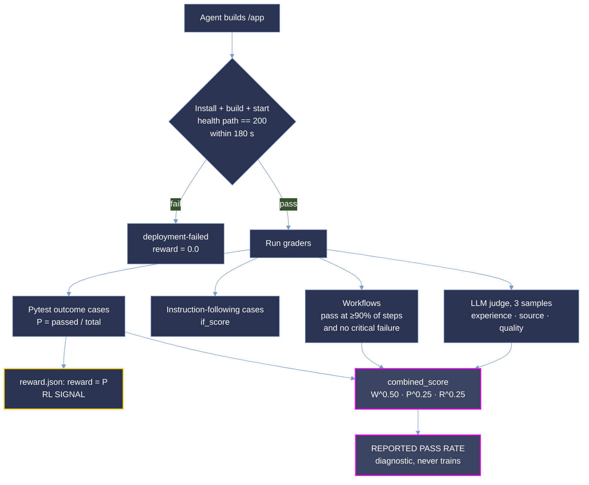

<p align="center">
  <picture>
    <source type="image/svg+xml" srcset="../images/hero.svg">
    
  </picture>
</p>

<p align="center">
  <strong>Measuring whether a coding agent can build a working web application from a prose brief alone.</strong>
</p>

<p align="center"><sub>
  <a href="#summary">Summary</a> · <a href="#whats-in-week-3">Week 3</a> · <a href="#repository-layout">Layout</a> · <a href="#difficulty-tiers">Tiers</a> · <a href="#results">Results</a> · <a href="#analysis">Analysis</a> · <a href="#coverage">Coverage</a> · <a href="#dataset-structure">Dataset</a> · <a href="#trajectory-structure">Trajectories</a> · <a href="#scoring-methodology">Scoring</a> · <a href="#running-a-task">Running</a>
</sub></p>

# Greenfield: Application Build Delivery — Week 3

**Greenfield measures whether a coding agent can turn a prose product brief into a deployed,
working web application that a stranger can drive in a browser.**

Each task hands an agent a long-form product specification, an empty `/app` and a service stack
(postgres, minio, mailpit on most tasks, plus others), and asks it to ship something that installs,
builds, answers a health probe and survives the task's own pytest suite, workflow checks and an LLM rubric that
drives a real browser. There is no repository to patch and no oracle diff to approximate.

This delivery is **broad and shallow: 75 tasks, 150 graded rollouts.** Every task carries one
`opus-5` run; 75 of the 75 also carry one `glm-5.3` run. With one run per task per model, every
per-task number here is **a single observation, not a rate**.

**0 of the 150 rollouts passed every workflow.** Throughout this document **pass rate is
`combined_score`** from `final_score.json`, as a percentage, averaged over runs where more than one is pooled:

```
combined_score = workflow^0.50 · pytest^0.25 · rubric^0.25
```

It is a partial-credit, geometric measure: one channel at zero takes the whole product to zero. This
is **not pass@k**.

> **Oracle score disclaimer.** The reference solution is guaranteed a score of 1.0 only on the
> deterministic channels (pytest). Wherever the LLM judge is involved, in the rubric on every task and
> in the workflows of 71 tasks, a perfect oracle score is not guaranteed. See
> [Oracle score](#oracle-score).

## Summary

| Property | Value |
| --- | --- |
| Tasks | 75 (all new in week 3) |
| Models | `opus-5` (75 runs), `glm-5.3` (75 runs) |
| Runs per task per model | 1 |
| Graded rollouts | 150; 148 with `judge = "scored"`, 1 `deployment-failed`, 1 judge `invalid` |
| Languages | TypeScript (69), Python (3), Go (3) |
| Agent harness | `openhands-sdk` on Harbor 0.24.0 |
| Grader | `rewardkit-0.2.3`, LLM judge, 3 samples per criterion |
| Reward signal | pytest outcome pass rate, `reward.json` |

Across all 150 rollouts the corpus pass rate is **17.59%** (σ 0.1835, range 0.000-0.805). That
number mixes two cohorts and should not be quoted on its own.

**`opus-5` beats `glm-5.3` on 72 of 75 shared tasks**, by 30.90 points on average (largest gap 80.52
points on `188e98f8`). 3 shared tasks tie (both models score the same).

Two numbers travel together throughout and must not be confused. **Pass rate is `combined_score`**,
the headline measure of how much of a task the agent actually delivered. **`reward.json` carries
`reward`, the pytest outcome pass rate alone**, and it is the only number that trains anything;
the grader labels `combined_score` a diagnostic.

## What's in week 3

- **75 new tasks** from Stage 2 that are not in the `kiro-greenfield` delivery. Selected by QC health from 106 new tasks and re-checked with a full QC.md review (every failed test and judge criterion traced to the agent's app or to the grader).
- Before delivery every bundle was QC'd against `QC.md`: every `task.toml` loads in Harbor 0.24 and validates
  against its schema, `grader.py validate` passes on every bundle, and every scored run's `combined_score`, `W`, `P`, `R`,
  `quality` and `if_score` were recomputed from the shipped `ctrf.json`, `judge.json` and `requirements.toml`.

## Repository layout

```
Week_3/
├── README.md                 # this document
└── <uuid>/                   # one self-contained directory per task (75)
    ├── task.toml, instruction.md, traceability-matrix.csv
    ├── environment/, solution/, tests/
    └── trajectories/
        ├── opus-5/run_1
        └── glm-5.3/run_1     # 75 of 75 tasks
```

Task directories are named by their `uuid_v5`, and every task is referred to by its 8-character
prefix. Each directory is a self-contained bundle: the brief, the environment that hosts it, a
reference solution, the grader, and the trajectories recorded against it. Every task's `task.toml`
also pins prebuilt multi-arch (`linux/amd64`, `linux/arm64`) env and tests images in ECR under
`[metadata.ecr]`.

Every table below is derived from the shipped `final_score.json`, `workflows.json`,
`verifier/` and `trajectory/trajectory.json` files. Nothing is hand-entered.

## Difficulty tiers

`task.toml` ships **no** `difficulty`, `pass_rate` or calibration fields in this delivery. The tiers
below are cut here, on the same bands as the wider Greenfield corpus, from the single `opus-5`
`combined_score` of each task:

| band | `combined_score` |
|---|---|
| `trivial` | ≥ 87.5% |
| `easy` | [50%, 87.5%) |
| `medium` | [37.5%, 50%) |
| `hard` | [25%, 37.5%) |
| `expert` | < 25% |

| tier | tasks on `opus-5` | tasks on `glm-5.3` (75) |
|---|--:|--:|
| `trivial` | 0 | 0 |
| `easy` | 2 | 0 |
| `medium` | 16 | 0 |
| `hard` | 43 | 2 |
| `expert` | 14 | 73 |

The two models put a task in the same band on **14 of 75** shared tasks. With one run per task,
a tier here is one draw, not a measured rate: a task one run away from a band edge could land in the
neighbouring band on a re-run. Treat these tiers as provisional until each task has repeated runs.

## Results

### Pass rate by task and model

Sorted by `opus-5`. `W` is workflows passed / total, `P` the pytest outcome pass rate, `R` the rubric
score. `—` means the task has no `glm-5.3` run.

| Task | `opus-5` | W | P | R | `glm-5.3` | W | P | R |
| --- | ---: | ---: | ---: | ---: | ---: | ---: | ---: | ---: |
| `188e98f8` roundkeeper | 80.52% | 8/12 | 0.946 | 1.000 | 0.00% | 0/12 | 0.135 | 0.267 |
| `3a4f9c6b` keelson | 75.55% | 8/13 | 0.938 | 0.917 | 33.01% | 2/13 | 0.654 | 0.767 |
| `9205f10d` crosshand | 48.36% | 3/12 | 0.875 | 1.000 | 0.00% | 0/12 | 0.292 | 0.609 |
| `645c528a` headstring | 48.14% | 4/13 | 0.655 | 0.867 | 0.00% | 0/13 | 0.027 | 0.217 |
| `f872975f` kerfwell | 47.51% | 3/11 | 0.812 | 0.843 | 25.33% | 1/11 | 0.552 | 0.902 |
| `a3966622` slackwater | 46.13% | 4/15 | 0.806 | 0.790 | 17.42% | 1/15 | 0.313 | 0.661 |
| `893ceba9` interline-desk | 46.08% | 3/12 | 0.797 | 0.905 | 0.00% | 0/12 | 0.430 | 0.679 |
| `27e5c5d1` kinfold | 45.19% | 3/13 | 0.826 | 0.948 | 0.00% | 0/13 | 0.377 | 0.776 |
| `b76c0217` galley-docs | 44.85% | 3/13 | 0.832 | 0.914 | 0.00% | 0/13 | 0.211 | 0.276 |
| `d298cbbd` strikeproof | 44.60% | 3/13 | 0.883 | 0.841 | 0.00% | 0/13 | 0.573 | 0.667 |
| `91afea8e` chauraha-bazaar | 43.30% | 3/12 | 0.733 | 0.767 | 0.00% | 0/12 | 0.311 | 0.600 |
| `9ed78e20` aldermoor-open-record | 42.87% | 3/14 | 0.800 | 0.919 | 0.00% | 0/14 | 0.528 | 0.758 |
| `3b1606ee` airfold | 42.74% | 3/14 | 0.784 | 0.926 | 0.00% | 0/14 | 0.386 | 0.632 |
| `a634f791` reference-desk | 41.78% | 2/10 | 0.791 | 0.963 | 0.00% | 0/10 | 0.647 | 0.840 |
| `4f60dc8f` gloamwork-shot-rig | 41.62% | 3/14 | 0.853 | 0.766 | 0.00% | 0/14 | 0.353 | 0.594 |
| `d14955b4` hushline | 39.82% | 2/12 | 0.905 | 1.000 | 0.00% | 0/12 | 0.613 | 0.667 |
| `8a7f3e55` relayline | 38.55% | 2/10 | 0.716 | 0.771 | 0.00% | 0/10 | 0.403 | 0.250 |
| `07f5444f` quirewell-stand-desk | 37.98% | 2/12 | 0.864 | 0.867 | 0.00% | 0/12 | 0.691 | 0.817 |
| `fa0d1078` sudoku | 36.99% | 2/13 | 0.908 | 0.871 | 0.00% | 0/13 | 0.446 | 0.629 |
| `a820122f` sixbell-rest-log | 36.58% | 2/12 | 0.736 | 0.875 | 0.00% | 0/12 | 0.033 | 0.388 |
| `a46b8d45` fittings-desk | 36.32% | 2/11 | 0.790 | 0.667 | 0.00% | 0/11 | 0.590 | 0.632 |
| `becc71f7` ourlet-consignment-desk | 35.98% | 2/13 | 0.795 | 0.891 | 0.00% | 0/13 | 0.145 | 0.000 |
| `160e307e` due-coin | 35.96% | 2/13 | 0.919 | 0.768 | 0.00% | 0/13 | 0.282 | 0.585 |
| `bab772c1` perilune-ledger | 35.91% | 2/14 | 0.815 | 1.000 | 0.00% | 0/14 | 0.496 | 0.493 |
| `f3c2d550` stowdeck | 35.64% | 2/12 | 0.775 | 0.750 | 21.69% | 1/12 | 0.637 | 0.500 |
| `e1d33317` fairline | 35.50% | 2/13 | 0.822 | 0.817 | 0.00% | 0/13 | 0.307 | 0.517 |
| `9533ebee` quillmoor-reserve | 35.48% | 2/14 | 0.777 | 1.000 | 0.00% | 0/14 | 0.394 | 0.619 |
| `410b0a62` tempoline | 35.14% | 3/14 | 0.609 | 0.545 | 0.00% | 0/14 | 0.228 | 0.712 |
| `f37fc654` spindrift-commission-stage | 34.81% | 2/14 | 0.756 | 0.952 | 0.00% | 0/14 | 0.398 | 0.581 |
| `bfb67a27` tallyslate | 34.76% | 2/13 | 0.783 | 0.788 | 0.00% | 0/13 | 0.196 | 0.682 |
| `8e494b6a` elastic | 34.55% | 2/14 | 0.787 | 0.887 | 0.00% | 0/14 | 0.181 | 0.604 |
| `227e831a` skinout | 34.46% | 2/13 | 0.632 | 0.943 | 22.46% | 1/13 | 0.456 | 0.943 |
| `f160d048` candour-bench | 34.27% | 2/14 | 0.811 | 0.833 | 0.00% | 0/14 | 0.243 | 0.683 |
| `d09edabd` keyway-bench | 34.26% | 3/16 | 0.701 | 0.559 | 0.00% | 0/16 | 0.309 | 0.603 |
| `24601f10` cupfold | 33.83% | 2/14 | 0.796 | 0.806 | 0.00% | 0/14 | 0.257 | 0.500 |
| `e2a9b5bf` lowlamp-field-log | 33.81% | 2/14 | 0.672 | 0.954 | 0.00% | 0/14 | 0.109 | 0.954 |
| `4804911b` vasant-talkies-interval | 33.40% | 4/24 | 0.672 | 0.667 | 0.00% | 0/24 | 0.172 | 0.583 |
| `47925b4c` gevelwerk | 33.38% | 2/13 | 0.748 | 0.702 | 0.00% | 0/13 | 0.121 | 0.526 |
| `bff3a720` longseat | 33.35% | 2/14 | 0.731 | 0.829 | 0.00% ‡ | 0/14 | 0.282 | — |
| `6783ee8a` brackenpad | 33.02% | 2/14 | 0.660 | 0.882 | 0.00% | 0/14 | 0.170 | 0.618 |
| `21fd03b2` rampwright-bench | 32.89% | 2/14 | 0.798 | 0.718 | 20.38% | 1/14 | 0.649 | 0.521 |
| `032b2af4` athlete-effort-network | 32.87% | 2/16 | 0.914 | 0.818 | 0.00% | 0/16 | 0.812 | 0.788 |
| `02f905f6` shelfmark | 32.33% | 2/12 | 0.535 | 0.735 | 0.00% | 0/12 | 0.282 | 0.694 |
| `833c86e9` booking | 32.26% | 2/14 | 0.777 | 0.683 | 0.00% | 0/14 | 0.252 | 0.767 |
| `c6b27312` tinework-gallery | 32.22% | 2/14 | 0.774 | 0.682 | 0.00% | 0/14 | 0.233 | 0.379 |
| `634b5fff` last-bundle | 32.17% | 2/14 | 0.612 | 0.857 | 0.00% | 0/14 | 0.235 | 0.357 |
| `b6f559f3` halation-studio | 32.15% | 2/14 | 0.815 | 0.643 | 0.00% | 0/14 | 0.315 | 0.464 |
| `f4a90c29` wren-calendar | 31.73% | 3/21 | 0.685 | 0.724 | 0.00% | 0/21 | 0.210 | 0.534 |
| `946a8343` spurline | 28.73% | 2/14 | 0.465 | 0.719 | 0.00% | 0/14 | 0.039 | 0.360 |
| `1160b78d` switchlamp | 27.99% | 2/19 | 0.604 | 0.917 | 0.00% | 0/19 | 0.011 | 0.450 |
| `96c941d4` squallglass | 27.88% | 1/9 | 0.634 | 0.772 | 0.00% | 0/9 | 0.293 | 0.386 |
| `5bff0ab1` malhar-key-on | 27.87% | 2/18 | 0.733 | 0.667 | 0.00% † | 0/18 | 0.000 | — |
| `450cf4b3` stationhouse | 27.26% | 1/12 | 0.870 | 0.914 | 20.16% | 1/12 | 0.493 | 0.483 |
| `c4542d52` holdfast-register | 27.24% | 1/12 | 0.793 | 1.000 | 0.00% | 0/12 | 0.133 | 0.456 |
| `d7ccae7f` lastbell | 26.77% | 1/12 | 0.849 | 0.871 | 0.00% | 0/12 | 0.679 | 0.919 |
| `d974eab3` vireo-pace-story | 26.74% | 1/13 | 0.907 | 0.952 | 0.00% | 0/13 | 0.627 | 0.794 |
| `e70f63d8` cricheroes | 26.06% | 1/13 | 0.868 | 0.898 | 0.00% | 0/13 | 0.363 | 0.559 |
| `fa58e169` twinrow | 25.72% | 1/13 | 0.871 | 0.849 | 0.00% | 0/13 | 0.267 | 0.641 |
| `bf208a6c` pinsheet | 25.66% | 1/14 | 0.886 | 0.960 | 0.00% | 0/14 | 0.293 | 0.811 |
| `d21868a7` ditchbook | 25.38% | 1/13 | 0.807 | 0.869 | 0.00% | 0/13 | 0.377 | 0.836 |
| `a0fc74b8` undersign | 25.14% | 1/13 | 0.789 | 0.855 | 0.00% | 0/13 | 0.250 | 0.800 |
| `64cce043` lockbox-ledger | 24.79% | 1/14 | 0.875 | 0.846 | 0.00% | 0/14 | 0.008 | 0.723 |
| `ecaf9927` kerfline-bench | 24.54% | 1/13 | 0.613 | 1.000 | 0.00% | 0/13 | 0.306 | 0.613 |
| `b9ed6f48` sightline-hall | 24.47% | 1/14 | 0.794 | 0.885 | 0.00% | 0/14 | 0.186 | 0.513 |
| `eb62b28b` ocotillo-member-desk | 24.46% | 1/13 | 0.803 | 0.754 | 0.00% | 0/13 | 0.092 | 0.661 |
| `d7d06515` corbel-draft | 24.14% | 1/13 | 0.683 | 0.841 | 0.00% | 0/13 | 0.098 | 0.580 |
| `d78a061d` linewright | 23.80% | 1/14 | 0.716 | 0.879 | 0.00% | 0/14 | 0.261 | 0.455 |
| `e1a41369` deedfall | 23.80% | 1/14 | 0.863 | 0.729 | 0.00% | 0/14 | 0.619 | 0.729 |
| `47bad8ab` overlap-crossword | 23.52% | 1/16 | 0.910 | 0.861 | 0.00% | 0/16 | 0.180 | 0.139 |
| `a0426c74` plotfold-sheets | 18.86% | 1/14 | 0.470 | 0.528 | 0.00% | 0/14 | 0.090 | 0.417 |
| `b597bb9c` gatecut | 17.82% | 1/22 | 0.612 | 0.797 | 0.00% | 0/22 | 0.082 | 0.453 |
| `f9641a08` roam-house | 17.82% | 1/14 | 0.681 | 0.290 | 0.00% | 0/14 | 0.153 | 0.387 |
| `0d31a2e4` pratfall-cup | 0.00% | 0/10 | 0.552 | 0.954 | 0.00% | 0/10 | 0.239 | 0.700 |
| `267caec2` cutline-awards-desk | 0.00% | 0/11 | 0.643 | 1.000 | 0.00% | 0/11 | 0.179 | 0.955 |
| `b6915223` elevens-fantasy | 0.00% | 0/13 | 0.559 | 0.917 | 0.00% | 0/13 | 0.221 | 0.317 |

† `deployment-failed`: the app did not pass the health gate, so the run is scored 0 and its rubric is not judged (`5bff0ab1` glm-5.3).

‡ judge `invalid`: the judge result was not usable; every workflow failed a critical step, so `combined_score` is 0 for any rubric (`bff3a720` glm-5.3).

**`0d31a2e4` pratfall-cup is the lowest `opus-5` task** at 0.00%; **`188e98f8` roundkeeper is the highest** at 80.52%
(8 of 12 workflows). `opus-5` scores zero on 3 of 75 tasks; `glm-5.3` on 68 of 75.

### Model comparison (75 shared tasks)

| | `opus-5` | `glm-5.3` | Δ |
| --- | ---: | ---: | ---: |
| Pass rate | 33.04% | 2.14% | -30.90 |
| Reward (pytest) | 76.36% | 31.30% | -45.06 |
| Workflows passed | 15.10% | 0.78% | -14.31 |
| Rubric `R` (scored runs) | 0.8316 | 0.5886 | -0.2430 |
| Tasks won | 72 | 0 | |

**Most `glm-5.3` zeros are workflow zeros.** 68 of its 68 zero-score runs passed no workflow, so
`workflow^0.50` is 0 and the product collapses even where pytest and rubric are above zero.

With n = 1 per task, no single-task gap can be separated from run-to-run noise.

## Analysis

**Check accuracy does not survive composition.** A workflow passes only when at least 90% of its steps pass **and** none of its
critical steps fail (`grader.py`: `passed * 10 >= total * 9 and not critical_failed`), so partial
competence collapses at the join.

| Channel (75 shared tasks) | `opus-5` | `glm-5.3` |
| --- | ---: | ---: |
| Workflows | 154 / 1,020 (15.10%) | 8 / 1,020 (0.78%) |
| Pytest outcome cases | 6,079 / 7,819 | 2,585 / 7,718 |
| `if_score` (instruction-following cases), mean | 0.9622 | 0.8452 |
| Critical-case failures | 1,365 | 3,908 |

**The workflow channel decides the headline.** Because `workflow` carries exponent 0.50, it moves
`combined_score` twice as hard as either other channel, and a zero there is unrecoverable.
**Critical failures cluster on a few tasks.** For `opus-5`, `a0426c74` (51), `946a8343` (43), `b597bb9c` (36), `227e831a` (35) account for 165 of 1,365 critical-case failures (12%). For `glm-5.3`, `47bad8ab` (138), `c4542d52` (105), `c6b27312` (102), `bf208a6c` (97) account for 442 of 3,908 critical-case failures (11%). 

**The rubric is high and fairly stable.** `opus-5`'s mean `R` is 0.8316, and 8 of its 75 runs score
`R = 1.000`. Each criterion is judged three times; the three samples agree unanimously on **1,605 of
1,864** `opus-5` criteria (86.1%) and **1,599 of 1,835** `glm-5.3` criteria (87.1%). `R` excludes the
`quality` criteria, which are reported separately (`quality` mean 0.533 for `opus-5`, 0.285 for
`glm-5.3`) and never enter `combined_score`.

**Deploy is a cliff, not a slope.** The grader installs and builds the delivered app, starts it and
waits for its health path to return HTTP 200 before any test runs. A run that misses it
is recorded as `deployment-failed` with `reward = 0.0`. 1 of the 150 rollouts in this delivery failed to deploy (`5bff0ab1` glm-5.3); all others deployed and were scored.

## Coverage

| Axis | Distribution |
| --- | --- |
| Language | typescript 69, python 3, go 3 |
| Archetype | individual 37, solo founder 26, enterprise 12 |
| Services | postgres 74, minio 63, mailpit 43, killbill 17, valkey 16, gotenberg 14, wiremock 11, meilisearch 10, rabbitmq 6, svix 6, ntfy 6, pocketbase 3, keycloak 3 |
| Category | Greenfield, all 75 |

Totals across the 75 tasks: **1,020 workflows**, **4,823 mandatory requirements**, **1,864 rubric
criteria** and **10,165 traceability rows**.

## Dataset structure

```
<task-uuid>/
├── task.toml                   task definition, incl. [metadata.ecr] image pins
├── instruction.md              the brief
├── traceability-matrix.csv     requirement → test / workflow / rubric coverage
├── environment/
│   ├── Dockerfile              the agent's container
│   └── docker-compose.yaml     backing services
├── solution/
│   ├── TRUTH.md                reference behaviour narrative
│   ├── app/                    reference application source + run.json
│   └── solve.sh
└── tests/
    ├── Dockerfile, docker-compose.yaml, test.sh
    └── grader/
        ├── grader.py           install, build, health gate, pytest, scoring
        ├── test_app.py, conftest.py, instrument.js
        ├── requirements.toml   requirements registry, workflows, critical cases
        ├── judge.py, judge.toml, prompt.md   LLM rubric judge
        └── instruction.md
```

`instruction.md` is the contract. `tests/grader/requirements.toml` is the registry the grader
enforces: requirements, workflows and which of their cases are critical. `traceability-matrix.csv`
maps each requirement to the tests, workflows and rubric criteria that exercise it.

**`solution/app/` ships reference application source** in every bundle
(33-353 files per task, excluding `node_modules`).

## Trajectory structure

```
run_1/
├── reward.json          reward (= pytest pass rate) plus workflow, pytest, rubric, quality, if_score, combined_score
├── final_score.json     combined_score, weights, per-channel breakdown, formula
├── workflows.json       summary + per-workflow verdicts
├── app/                 the application the agent built
├── screenshots/         judge captures, by profile: normal/, and on most runs reduced/ and touch/
├── trajectory/
│   └── trajectory.json  openhands-sdk steps + final_metrics
└── verifier/
    ├── ctrf.json        CTRF-format pytest report
    └── judge.json       per-criterion rubric verdicts, 3 samples each, with reasoning
```

The delivery carries **4,910 screenshots** across the 150 rollouts (2,555 `opus-5`, 2,355 `glm-5.3`),
captured by the judge. 149 runs have a normal profile; 133 also have touch and 71 also have
reduced motion.
## Scoring methodology



### How the channels combine

`combined_score` is a **weighted geometric mean**, not a weighted average:

```
combined_score = W^0.50 · P^0.25 · R^0.25
```

- **`W`**, workflow pass rate. A workflow passes when at least 90% of its steps pass and none of its
  critical steps fail. On 140 of the 150 runs (`workflow_basis = "pytest + judge checkpoints"`), judge
  checkpoints count as workflow steps alongside pytest cases.
- **`P`**, pytest pass rate over outcome cases. Instruction-following cases are excluded from `P` and
  reported as `if_score`.
- **`R`**, the rubric: a weighted mean of the judge's `experience` and `source` criteria (weights
  5 / 3 / 1 for critically important / important / somewhat important). `quality` criteria are
  scored but excluded from `R`.

**A weak channel cannot be bought back.** Under a geometric mean the product is dragged toward its
weakest term, and a zero anywhere is a zero overall. 71 of the 71 zero-score runs in this delivery are
`W = 0` runs.

### The RL signal

`reward.json`'s `reward` is `P`, the pytest outcome pass rate, and nothing else. It is reproducible
on stock Harbor without the judge. `W`, `R`, `quality`, `if_score` and `combined_score` sit beside
it in the same file as diagnostics.

### LLM rubric

The judge runs in batched mode with **3 samples per criterion** and a Playwright MCP server restricted to browsing tools, so `experience` criteria are judged from a
live render and `source` / `quality` criteria from the delivered files (`file:line` evidence).
Each criterion in `verifier/judge.json` carries its three samples, their agreement and the judge's
reasoning.

### Oracle score

The oracle run (`harbor run -p <task-uuid> -a oracle`, whose `solution/solve.sh` copies `solution/app/` into `/app`) is the reference
solution scored by the same grader as the agents. **A score of 1.0 is deterministic only where no
LLM judge is involved:**

| Channel | Graded by | Oracle score of 1.0 |
| --- | --- | --- |
| `P`, pytest outcome cases (`reward`) | pytest | deterministic |
| `if_score`, instruction-following cases | pytest | deterministic |
| `W`, workflows built only from pytest cases | pytest | deterministic |
| `W` on tasks whose workflows include judge checkpoints | pytest + LLM judge | **not guaranteed** |
| `R`, rubric (and `quality`) | LLM judge, 3 samples | **not guaranteed** |
| `combined_score` | `W^0.50 · P^0.25 · R^0.25` | **not guaranteed** on any task, because `R` enters it |

The judge is a sampled language model. It can fail a correct reference implementation on any
rubric criterion or judge checkpoint, and the same oracle can score differently from one run to the
next. 71 tasks put judge checkpoints into their workflows (`checkpoints` in
`tests/grader/requirements.toml`): `02f905f6`, `07f5444f`, `1160b78d`, `160e307e`, `188e98f8`, `21fd03b2`, `227e831a`, `24601f10`, `267caec2`, `27e5c5d1`, `3b1606ee`, `410b0a62`, `450cf4b3`, `47925b4c`, `47bad8ab`, `4804911b`, `4f60dc8f`, `5bff0ab1`, `634b5fff`, `645c528a`, `64cce043`, `6783ee8a`, `833c86e9`, `893ceba9`, `8a7f3e55`, `8e494b6a`, `91afea8e`, `9205f10d`, `946a8343`, `9533ebee`, `96c941d4`, `a0426c74`, `a0fc74b8`, `a3966622`, `a46b8d45`, `a634f791`, `a820122f`, `b597bb9c`, `b6915223`, `b6f559f3`, `b76c0217`, `b9ed6f48`, `bab772c1`, `becc71f7`, `bf208a6c`, `bfb67a27`, `bff3a720`, `c4542d52`, `c6b27312`, `d09edabd`, `d14955b4`, `d21868a7`, `d298cbbd`, `d78a061d`, `d7ccae7f`, `d7d06515`, `d974eab3`, `e1a41369`, `e1d33317`, `e2a9b5bf`, `e70f63d8`, `eb62b28b`, `ecaf9927`, `f160d048`, `f37fc654`, `f3c2d550`, `f4a90c29`, `f872975f`, `f9641a08`, `fa0d1078`, `fa58e169`. On those tasks the oracle's `W` can also fall
below 1.0. On the other 4 tasks `W` is pytest-only and deterministic.

So an oracle `reward` (`P`) below 1.0 is a real defect in the task or its solution. An oracle `R`,
judge-checkpoint `W` or `combined_score` below 1.0 may be judge variance, not a fault in the
solution, and should be re-run or reviewed by a person before it is treated as one. No oracle
results are shipped in this delivery.

## Running a task

The env and tests images for every task are pinned by digest in `task.toml` under
`[metadata.ecr]`, and `[environment].docker_image` / `[verifier.environment].docker_image` point
Harbor at them, so Harbor pulls rather than builds. The repository is private; log in first:

```bash
aws ecr get-login-password --region ap-south-1 \
  | docker login --username AWS --password-stdin 426628337772.dkr.ecr.ap-south-1.amazonaws.com
harbor run -p <task-uuid> -a <agent>
```

Each image is a multi-arch index (`linux/amd64`, `linux/arm64`), so Docker pulls the native
variant. `harbor run --force-build` still builds the agent's environment from
`environment/Dockerfile`. Grading needs the backing services in `environment/docker-compose.yaml`
and judge credentials.
