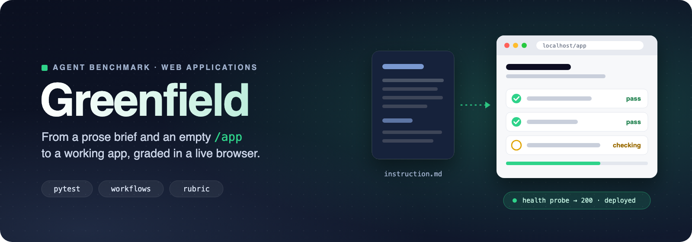
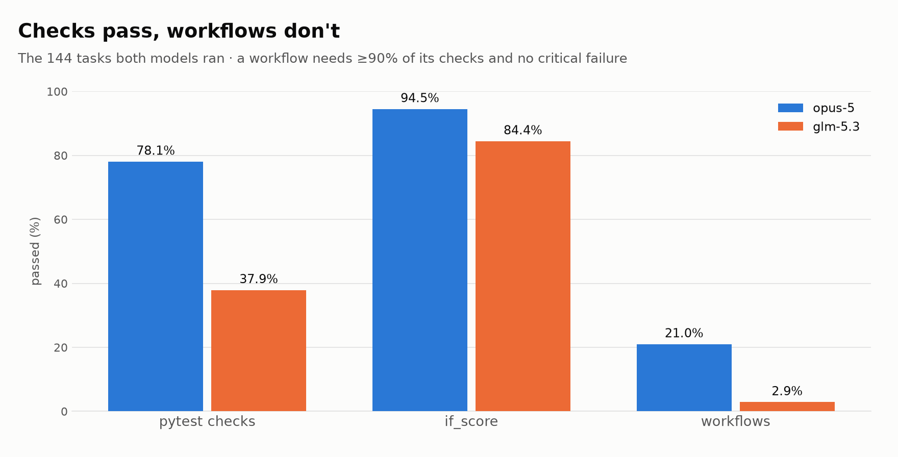
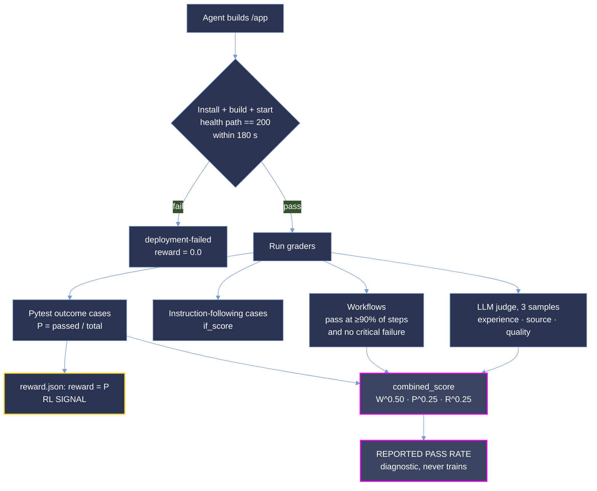

<p align="center">
  <picture>
    <source type="image/svg+xml" srcset="images/hero.svg">
    
  </picture>
</p>

<p align="center">
  <strong>Measuring whether a coding agent can build a working web application from a prose brief alone.</strong>
</p>

<p align="center">
  <a href="#summary"></a>
  <a href="#scoring-methodology"></a>
  <a href="#difficulty-tiers"></a>
</p>

<p align="center"><sub>
  <a href="#summary">Summary</a> · <a href="#whats-in-this-delivery">This delivery</a> · <a href="#repository-layout">Layout</a> · <a href="#difficulty-tiers">Tiers</a> · <a href="#results">Results</a> · <a href="#analysis">Analysis</a> · <a href="#coverage">Coverage</a> · <a href="#dataset-structure">Dataset</a> · <a href="#trajectory-structure">Trajectories</a> · <a href="#scoring-methodology">Scoring</a> · <a href="#running-a-task">Running</a>
</sub></p>

# Greenfield: Application Build Delivery

**Greenfield measures whether a coding agent can turn a prose product brief into a deployed,
working web application that a stranger can drive in a browser.**

Each task hands an agent a long-form product specification, an empty `/app` and a service stack
(PostgreSQL on almost every task, plus any of Mailpit, MinIO, Kill Bill, Keycloak, PocketBase and others), and asks it to ship
something that installs, builds, answers a health probe and survives the task's own pytest suite,
workflow checks and an LLM rubric that drives a real browser. There is no repository to patch and no
oracle diff to approximate.

This delivery is **broad and shallow: 145 tasks, 289 graded rollouts.** Every task carries one
`opus-5` run; 144 of the 145 also carry one `glm-5.3` run. With one run per task per model, every
per-task number here is **a single observation, not a rate**, and the two cohorts are only directly
comparable on the 144 tasks they share.

**Not one of the 289 rollouts passed every workflow.** Throughout this document **pass rate is
`combined_score`** from `final_score.json`, as a percentage, averaged over runs where more than one
is pooled:

```
combined_score = workflow^0.50 · pytest^0.25 · rubric^0.25
```

It is a partial-credit, geometric measure: one channel at zero takes the whole product to zero. This
is **not pass@k**.

> **Oracle score disclaimer.** The reference solution is guaranteed a score of 1.0 only on the
> deterministic channels (pytest). Wherever the LLM judge is involved, in the rubric on every task and
> in the workflows of 120 tasks, a perfect oracle score is not guaranteed. See
> [Oracle score](#oracle-score).

## Summary

| Property | Value |
| --- | --- |
| Tasks | 145 (25 from week 1, 50 from week 2, 70 new in week 3) |
| Models | `opus-5` (145 runs), `glm-5.3` (144 runs) |
| Runs per task per model | 1 |
| Graded rollouts | 289; 286 with `judge = "scored"`, 3 `deployment-failed` |
| Languages | TypeScript (126), Python (12), Go (4), JavaScript (3) |
| Agent harness | `openhands-sdk` on Harbor 0.24.0 |
| Grader | `rewardkit-0.2.3`, LLM judge, 3 samples per criterion |
| Reward signal | pytest outcome pass rate, `reward.json` |

Across all 289 rollouts the corpus pass rate is **22.48%** (σ 0.2226, range 0.000-0.811). That
number mixes two cohorts and should not be quoted on its own.

**`opus-5` beats `glm-5.3` on 140 of 144 shared tasks** (`glm-5.3` wins `e76c8222`), by 33.67 points on average (largest gap 80.52
points on `188e98f8`). 3 shared tasks tie (both models score the same).

Two numbers travel together throughout and must not be confused. **Pass rate is `combined_score`**,
the headline measure of how much of a task the agent actually delivered. **`reward.json` carries
`reward`, the pytest outcome pass rate alone**, and it is the only number that trains anything;
the grader labels `combined_score` a diagnostic.

## What's in this delivery

- **25 tasks from the first delivery**, unchanged except that `glm-5.3` runs were added
  for `1bc089d6`, `3ed42748`, `5559ceaa`, `7a50c331`, `c8622c96` (week 2) and `1c568f2d`, `3a79fa7f`, `a6e8fa11` (week 3).
  `a6e8fa11` also ships its updated grader (new tests image) and both of its runs are graded by it, so its `opus-5`
  score is 78.06% (was 82.46% under the old grader).
- **50 tasks from the second delivery**, unchanged.
- **70 new tasks in week 3**, each with one `opus-5` and one `glm-5.3` run. Before delivery their trajectories
  were checked for leaked provider ids (redacted to `[REDACTED]`), every `task.toml` loads in Harbor 0.24 and validates
  against its schema, `grader.py validate` passes on every bundle, and every scored run's scores recompute from its
  shipped `ctrf.json`, `judge.json` and `requirements.toml`.
- **1 task still carries `opus-5` only:** `065a9171`.

## Repository layout

```
kiro-greenfield/
├── README.md                 # this document
├── images/                   # hero and the composition-gap chart (light and dark)
└── <uuid>/                   # one self-contained directory per task (145)
    ├── task.toml, instruction.md, traceability-matrix.csv
    ├── environment/, solution/, tests/
    └── trajectories/
        ├── opus-5/run_1
        └── glm-5.3/run_1     # 144 of 145 tasks
```

Task directories are named by their `uuid_v5`, and every task is referred to by its 8-character
prefix. Each directory is a self-contained bundle: the brief, the environment that hosts it, a
reference solution, the grader, and the trajectories recorded against it. Every task's `task.toml`
also pins prebuilt multi-arch (`linux/amd64`, `linux/arm64`) env and tests images in ECR under
`[metadata.ecr]`.

Every table below is derived from the shipped `final_score.json`, `workflows.json`,
`verifier/` and `trajectory/trajectory.json` files. Nothing is hand-entered.

## Difficulty tiers

`task.toml` ships **no** `difficulty`, `pass_rate` or calibration fields in this delivery. The tiers
below are cut here, on the same bands as the wider Greenfield corpus, from the single `opus-5`
`combined_score` of each task:

| band | `combined_score` |
|---|---|
| `trivial` | ≥ 87.5% |
| `easy` | [50%, 87.5%) |
| `medium` | [37.5%, 50%) |
| `hard` | [25%, 37.5%) |
| `expert` | < 25% |

| tier | tasks on `opus-5` | tasks on `glm-5.3` (144) |
|---|--:|--:|
| `trivial` | 0 | 0 |
| `easy` | 22 | 4 |
| `medium` | 47 | 2 |
| `hard` | 52 | 7 |
| `expert` | 24 | 131 |

The two models put a task in the same band on **28 of 144** shared tasks. With one run per task,
a tier here is one draw, not a measured rate: a task one run away from a band edge could land in the
neighbouring band on a re-run. Treat these tiers as provisional until each task has repeated runs.

## Results

### Pass rate by task and model

Sorted by `opus-5`. `W` is workflows passed / total, `P` the pytest outcome pass rate, `R` the rubric
score. `—` means the task has no `glm-5.3` run; `wk` is the week the task was first delivered.

| Task | wk | `opus-5` | W | P | R | `glm-5.3` | W | P | R |
| --- | :-: | ---: | ---: | ---: | ---: | ---: | ---: | ---: | ---: |
| `dd09740b` agency-inquiry-desk | 2 | 81.07% | 11/14 | 0.973 | 0.719 | 37.11% | 3/14 | 0.735 | 0.562 |
| `188e98f8` roundkeeper | 3 | 80.52% | 8/12 | 0.946 | 1.000 | 0.00% | 0/12 | 0.135 | 0.267 |
| `acf3d1b6` video-credit-studio | 1 | 80.03% | 5/7 | 0.933 | 0.862 | 0.00% | 0/7 | 0.756 | 0.862 |
| `a8936445` stationkeeper | 1 | 78.07% | 10/14 | 0.921 | 0.790 | 59.53% | 6/14 | 0.865 | 0.790 |
| `a6e8fa11` furrowbook | 1 | 78.06% | 9/13 | 0.936 | 0.828 | 0.00% | 0/13 | 0.480 | 0.741 |
| `f9ef9fe2` pilotlight | 1 | 76.55% | 8/13 | 0.907 | 1.000 | 50.06% | 5/13 | 0.733 | 0.579 |
| `3a4f9c6b` keelson | 3 | 75.55% | 8/13 | 0.938 | 0.917 | 33.01% | 2/13 | 0.654 | 0.767 |
| `cc20dbf3` shedline | 1 | 75.37% | 9/13 | 0.930 | 0.724 | 22.79% | 1/13 | 0.630 | 0.724 |
| `d2fda3ba` cairn-field-notebook | 2 | 74.02% | 7/12 | 0.882 | 1.000 | 0.00% | 0/12 | 0.441 | 0.203 |
| `f0ef5446` partner-program-intake | 2 | 73.25% | 5/9 | 0.933 | 1.000 | 0.00% | 0/9 | 0.732 | 0.860 |
| `0fe016e0` feature-flag-rollout-ladder | 1 | 73.03% | 4/7 | 0.871 | 1.000 | 0.00% | 0/7 | 0.452 | 0.145 |
| `1bc089d6` stillhour | 1 | 72.18% | 7/12 | 0.926 | 0.862 | 0.00% | 0/12 | 0.638 | 0.569 |
| `03ec7574` treasury-quorum-console | 1 | 66.26% | 10/18 | 0.843 | 0.741 | 61.19% | 9/18 | 0.757 | 0.741 |
| `f7780386` passboard | 1 | 65.57% | 6/12 | 0.880 | 0.841 | 22.61% | 1/12 | 0.590 | 0.638 |
| `bc58b4f3` teamseat | 2 | 64.85% | 5/10 | 0.860 | 0.823 | 0.00% | 0/10 | 0.495 | 0.871 |
| `8f4910c6` rungboard | 2 | 62.14% | 6/13 | 0.843 | 0.831 | 0.00% | 0/13 | 0.236 | 0.864 |
| `1c568f2d` exhibit-clearance-desk | 1 | 60.86% | 5/11 | 0.841 | 0.789 | 0.00% † | 0/11 | 0.000 | 0.000 |
| `065a9171` tallow-cover | 1 | 55.62% | 5/14 | 0.793 | 0.946 | — | | | |
| `09ede887` conference-workshop-booking-vb | 2 | 54.94% | 3/9 | 0.820 | 1.000 | 51.34% | 3/9 | 0.739 | 0.846 |
| `107eb6d6` tour-freight-desk | 1 | 54.59% | 4/11 | 0.771 | 0.871 | 37.98% | 2/11 | 0.723 | 0.871 |
| `c8622c96` saltprint-desk | 1 | 51.54% | 5/14 | 0.830 | 0.667 | 0.00% | 0/14 | 0.420 | 0.228 |
| `3a79fa7f` efoil-build-checkout-vb | 1 | 51.40% | 5/15 | 0.868 | 0.724 | 0.00% † | 0/15 | 0.000 | 0.000 |
| `b3014344` pampero-build-ledger | 2 | 49.56% | 4/14 | 0.835 | 0.886 | 0.00% | 0/14 | 0.551 | 0.629 |
| `76b76d2d` halide-box-office | 2 | 49.40% | 5/15 | 0.673 | 0.797 | 0.00% | 0/15 | 0.575 | 0.750 |
| `0a24efbb` attendance-regularisation-desk | 2 | 48.86% | 3/11 | 0.833 | 0.919 | 26.19% | 1/11 | 0.706 | 0.806 |
| `5306a075` loomwise-evidence-desk | 1 | 48.84% | 4/13 | 0.758 | 0.793 | 0.00% | 0/13 | 0.439 | 0.741 |
| `be6632fd` hourline | 2 | 48.37% | 4/13 | 0.819 | 0.706 | 0.00% | 0/13 | 0.324 | 0.500 |
| `645c528a` headstring | 3 | 48.14% | 4/13 | 0.655 | 0.867 | 0.00% | 0/13 | 0.027 | 0.217 |
| `fa34a58b` nightplan-hub | 2 | 47.84% | 3/11 | 0.742 | 0.948 | 0.00% | 0/11 | 0.212 | 0.517 |
| `1e363484` fluxseal | 2 | 47.53% | 3/11 | 0.889 | 0.772 | 22.91% | 1/11 | 0.543 | 0.614 |
| `f872975f` kerfwell | 3 | 47.51% | 3/11 | 0.812 | 0.843 | 25.33% | 1/11 | 0.552 | 0.902 |
| `d4519147` scopewright | 2 | 47.37% | 3/12 | 0.902 | 0.893 | 0.00% | 0/12 | 0.719 | 0.804 |
| `14b4e0bc` strata-catalog | 2 | 47.19% | 4/15 | 0.811 | 0.860 | 0.00% | 0/15 | 0.358 | 0.632 |
| `7c716c2d` tallyroom | 2 | 47.11% | 4/14 | 0.763 | 0.790 | 0.00% | 0/14 | 0.226 | 0.742 |
| `a7893e48` hearthshift | 1 | 46.62% | 3/12 | 0.825 | 0.917 | 0.00% | 0/12 | 0.577 | 0.183 |
| `66a9444b` kerf-frequencies | 1 | 46.40% | 3/12 | 0.785 | 0.944 | 0.00% | 0/12 | 0.194 | 0.704 |
| `a3966622` slackwater | 3 | 46.13% | 4/15 | 0.806 | 0.790 | 17.42% | 1/15 | 0.313 | 0.661 |
| `893ceba9` interline-desk | 3 | 46.08% | 3/12 | 0.797 | 0.905 | 0.00% | 0/12 | 0.430 | 0.679 |
| `941822d9` credwell | 1 | 45.73% | 3/13 | 0.821 | 1.000 | 0.00% | 0/13 | 0.095 | 0.448 |
| `27e5c5d1` kinfold | 3 | 45.19% | 3/13 | 0.826 | 0.948 | 0.00% | 0/13 | 0.377 | 0.776 |
| `b76c0217` galley-docs | 3 | 44.85% | 3/13 | 0.832 | 0.914 | 0.00% | 0/13 | 0.211 | 0.276 |
| `cf669c8e` ommezwaai-feeler | 2 | 44.82% | 5/17 | 0.655 | 0.712 | 0.00% | 0/17 | 0.262 | 0.411 |
| `d298cbbd` strikeproof | 3 | 44.60% | 3/13 | 0.883 | 0.841 | 0.00% | 0/13 | 0.573 | 0.667 |
| `8061ec0b` bellroll | 2 | 44.45% | 3/13 | 0.800 | 0.917 | 0.00% | 0/13 | 0.090 | 0.750 |
| `0b297f2f` hangline | 2 | 44.13% | 3/13 | 0.872 | 0.817 | 0.00% | 0/13 | 0.414 | 0.633 |
| `05439808` saltreach | 2 | 43.96% | 3/12 | 0.861 | 0.694 | 24.04% | 1/12 | 0.693 | 0.694 |
| `4e567a88` lumenfold-dispatch | 2 | 43.65% | 3/12 | 0.779 | 0.746 | 0.00% | 0/12 | 0.500 | 0.600 |
| `fe5b78f3` pakka-berth | 2 | 43.52% | 3/12 | 0.769 | 0.746 | 20.39% | 1/12 | 0.490 | 0.508 |
| `91afea8e` chauraha-bazaar | 3 | 43.30% | 3/12 | 0.733 | 0.767 | 0.00% | 0/12 | 0.311 | 0.600 |
| `3e25b869` loafline | 2 | 43.12% | 3/13 | 0.708 | 0.917 | 0.00% | 0/13 | 0.194 | 0.783 |
| `d5bda8ea` community-event-rsvp-vb | 2 | 42.75% | 3/14 | 0.811 | 0.897 | 41.44% | 3/14 | 0.792 | 0.810 |
| `3b1606ee` airfold | 3 | 42.74% | 3/14 | 0.784 | 0.926 | 0.00% | 0/14 | 0.386 | 0.632 |
| `1aa0da7f` wardline | 2 | 42.48% | 3/14 | 0.741 | 0.957 | 0.00% | 0/14 | 0.224 | 0.362 |
| `eec0a822` tidewright | 2 | 42.47% | 3/13 | 0.747 | 0.818 | 0.00% | 0/13 | 0.133 | 0.654 |
| `4e75f56f` opaline-bench-days | 2 | 42.26% | 3/14 | 0.769 | 0.903 | 0.00% | 0/14 | 0.323 | 0.774 |
| `a634f791` reference-desk | 3 | 41.78% | 2/10 | 0.791 | 0.963 | 0.00% | 0/10 | 0.647 | 0.840 |
| `5e58bb82` swathdeck | 2 | 41.76% | 5/22 | 0.745 | 0.790 | 35.83% | 5/22 | 0.520 | 0.613 |
| `e7dd0ed1` farshore-console | 2 | 41.73% | 4/18 | 0.732 | 0.838 | 0.00% † | 0/18 | 0.000 | 0.000 |
| `4f60dc8f` gloamwork-shot-rig | 3 | 41.62% | 3/14 | 0.853 | 0.766 | 0.00% | 0/14 | 0.353 | 0.594 |
| `d14955b4` hushline | 3 | 39.82% | 2/12 | 0.905 | 1.000 | 0.00% | 0/12 | 0.613 | 0.667 |
| `1bd57c5f` snaglight-walkthrough | 2 | 39.66% | 4/19 | 0.744 | 0.750 | 0.00% | 0/19 | 0.233 | 0.804 |
| `376c7c28` stackfire-kiln-desk | 2 | 39.64% | 2/11 | 0.816 | 0.915 | 24.92% | 1/11 | 0.671 | 0.695 |
| `347522e8` railside | 2 | 39.51% | 3/14 | 0.750 | 0.708 | 16.66% | 1/14 | 0.317 | 0.477 |
| `a48ecbeb` ceibo-sparkling-mate | 2 | 38.64% | 2/12 | 0.803 | 1.000 | 0.00% | 0/12 | 0.224 | 0.097 |
| `8a7f3e55` relayline | 3 | 38.55% | 2/10 | 0.716 | 0.771 | 0.00% | 0/10 | 0.403 | 0.250 |
| `bcf42373` cinematic-developer-casebook-vb | 1 | 38.38% | 2/11 | 0.791 | 0.831 | 25.41% | 1/11 | 0.744 | 0.678 |
| `07f5444f` quirewell-stand-desk | 3 | 37.98% | 2/12 | 0.864 | 0.867 | 0.00% | 0/12 | 0.691 | 0.817 |
| `15996f31` swarmline-bloom-desk | 1 | 37.53% | 2/11 | 0.600 | 1.000 | 0.00% | 0/11 | 0.383 | 0.844 |
| `e7e372c1` tracewell-treasury-record | 2 | 37.51% | 2/12 | 0.775 | 0.919 | 0.00% | 0/12 | 0.050 | 0.919 |
| `67d48d61` promptside | 2 | 37.01% | 2/13 | 0.888 | 0.893 | 0.00% | 0/13 | 0.533 | 0.768 |
| `fa0d1078` sudoku | 3 | 36.99% | 2/13 | 0.908 | 0.871 | 0.00% | 0/13 | 0.446 | 0.629 |
| `9b5bc422` oddment | 2 | 36.66% | 2/13 | 0.833 | 0.915 | 0.00% | 0/13 | 0.333 | 0.864 |
| `a9ab5d5e` twohouse-handover | 3 | 36.55% | 3/14 | 0.822 | 0.473 | 0.00% | 0/14 | 0.414 | 0.164 |
| `3ed42748` parcel-moon | 1 | 36.52% | 2/13 | 0.830 | 0.906 | 0.00% | 0/13 | 0.557 | 0.500 |
| `a46b8d45` fittings-desk | 3 | 36.32% | 2/11 | 0.790 | 0.667 | 0.00% | 0/11 | 0.590 | 0.632 |
| `becc71f7` ourlet-consignment-desk | 3 | 35.98% | 2/13 | 0.795 | 0.891 | 0.00% | 0/13 | 0.145 | 0.000 |
| `160e307e` due-coin | 3 | 35.96% | 2/13 | 0.919 | 0.768 | 0.00% | 0/13 | 0.282 | 0.585 |
| `bab772c1` perilune-ledger | 3 | 35.91% | 2/14 | 0.815 | 1.000 | 0.00% | 0/14 | 0.496 | 0.493 |
| `f3c2d550` stowdeck | 3 | 35.64% | 2/12 | 0.775 | 0.750 | 21.69% | 1/12 | 0.637 | 0.500 |
| `e1d33317` fairline | 3 | 35.50% | 2/13 | 0.822 | 0.817 | 0.00% | 0/13 | 0.307 | 0.517 |
| `9533ebee` quillmoor-reserve | 3 | 35.48% | 2/14 | 0.777 | 1.000 | 0.00% | 0/14 | 0.394 | 0.619 |
| `659ff5a8` conecount-paddock | 2 | 35.47% | 2/13 | 0.836 | 0.800 | 0.00% | 0/13 | 0.060 | 0.691 |
| `410b0a62` tempoline | 3 | 35.14% | 3/14 | 0.609 | 0.545 | 0.00% | 0/14 | 0.228 | 0.712 |
| `dd026e33` lacquer-motor-house | 2 | 35.06% | 2/12 | 0.688 | 0.790 | 0.00% | 0/12 | 0.172 | 0.710 |
| `f37fc654` spindrift-commission-stage | 3 | 34.81% | 2/14 | 0.756 | 0.952 | 0.00% | 0/14 | 0.398 | 0.581 |
| `bfb67a27` tallyslate | 3 | 34.76% | 2/13 | 0.783 | 0.788 | 0.00% | 0/13 | 0.196 | 0.682 |
| `8e494b6a` elastic | 3 | 34.55% | 2/14 | 0.787 | 0.887 | 0.00% | 0/14 | 0.181 | 0.604 |
| `227e831a` skinout | 3 | 34.46% | 2/13 | 0.632 | 0.943 | 22.46% | 1/13 | 0.456 | 0.943 |
| `f160d048` candour-bench | 3 | 34.27% | 2/14 | 0.811 | 0.833 | 0.00% | 0/14 | 0.243 | 0.683 |
| `d09edabd` keyway-bench | 3 | 34.26% | 3/16 | 0.701 | 0.559 | 0.00% | 0/16 | 0.309 | 0.603 |
| `24601f10` cupfold | 3 | 33.83% | 2/14 | 0.796 | 0.806 | 0.00% | 0/14 | 0.257 | 0.500 |
| `e2a9b5bf` lowlamp-field-log | 3 | 33.81% | 2/14 | 0.672 | 0.954 | 0.00% | 0/14 | 0.109 | 0.954 |
| `4804911b` vasant-talkies-interval | 3 | 33.40% | 4/24 | 0.672 | 0.667 | 0.00% | 0/24 | 0.172 | 0.583 |
| `47925b4c` gevelwerk | 3 | 33.38% | 2/13 | 0.748 | 0.702 | 0.00% | 0/13 | 0.121 | 0.526 |
| `6783ee8a` brackenpad | 3 | 33.02% | 2/14 | 0.660 | 0.882 | 0.00% | 0/14 | 0.170 | 0.618 |
| `21fd03b2` rampwright-bench | 3 | 32.89% | 2/14 | 0.798 | 0.718 | 20.38% | 1/14 | 0.649 | 0.521 |
| `032b2af4` athlete-effort-network | 3 | 32.87% | 2/16 | 0.914 | 0.818 | 0.00% | 0/16 | 0.812 | 0.788 |
| `02f905f6` shelfmark | 3 | 32.33% | 2/12 | 0.535 | 0.735 | 0.00% | 0/12 | 0.282 | 0.694 |
| `833c86e9` booking | 3 | 32.26% | 2/14 | 0.777 | 0.683 | 0.00% | 0/14 | 0.252 | 0.767 |
| `c6b27312` tinework-gallery | 3 | 32.22% | 2/14 | 0.774 | 0.682 | 0.00% | 0/14 | 0.233 | 0.379 |
| `634b5fff` last-bundle | 3 | 32.17% | 2/14 | 0.612 | 0.857 | 0.00% | 0/14 | 0.235 | 0.357 |
| `b6f559f3` halation-studio | 3 | 32.15% | 2/14 | 0.815 | 0.643 | 0.00% | 0/14 | 0.315 | 0.464 |
| `fb5153e6` turnstone-studio | 2 | 32.08% | 2/13 | 0.575 | 0.778 | 0.00% | 0/13 | 0.315 | 0.746 |
| `f4a90c29` wren-calendar | 3 | 31.73% | 3/21 | 0.685 | 0.724 | 0.00% | 0/21 | 0.210 | 0.534 |
| `c2102b00` tally-split | 2 | 30.47% | 2/18 | 0.805 | 0.867 | 0.00% | 0/18 | 0.283 | 0.583 |
| `946a8343` spurline | 3 | 28.73% | 2/14 | 0.465 | 0.719 | 0.00% | 0/14 | 0.039 | 0.360 |
| `1160b78d` switchlamp | 3 | 27.99% | 2/19 | 0.604 | 0.917 | 0.00% | 0/19 | 0.011 | 0.450 |
| `96c941d4` squallglass | 3 | 27.88% | 1/9 | 0.634 | 0.772 | 0.00% | 0/9 | 0.293 | 0.386 |
| `f527cbc8` clinchline | 2 | 27.62% | 3/24 | 0.678 | 0.549 | 0.00% | 0/24 | 0.261 | 0.231 |
| `5559ceaa` relay-bench | 1 | 27.39% | 1/11 | 0.750 | 0.907 | 0.00% | 0/11 | 0.619 | 0.704 |
| `450cf4b3` stationhouse | 3 | 27.26% | 1/12 | 0.870 | 0.914 | 20.16% | 1/12 | 0.493 | 0.483 |
| `c4542d52` holdfast-register | 3 | 27.24% | 1/12 | 0.793 | 1.000 | 0.00% | 0/12 | 0.133 | 0.456 |
| `d7ccae7f` lastbell | 3 | 26.77% | 1/12 | 0.849 | 0.871 | 0.00% | 0/12 | 0.679 | 0.919 |
| `d974eab3` vireo-pace-story | 3 | 26.74% | 1/13 | 0.907 | 0.952 | 0.00% | 0/13 | 0.627 | 0.794 |
| `54c4ef10` edgeprint | 2 | 26.69% | 1/12 | 0.800 | 0.914 | 0.00% | 0/12 | 0.012 | 0.190 |
| `e70f63d8` cricheroes | 3 | 26.06% | 1/13 | 0.868 | 0.898 | 0.00% | 0/13 | 0.363 | 0.559 |
| `e387e0cd` lanternline | 2 | 25.77% | 1/13 | 0.811 | 0.919 | 21.42% | 1/13 | 0.432 | 0.823 |
| `fa58e169` twinrow | 3 | 25.72% | 1/13 | 0.871 | 0.849 | 0.00% | 0/13 | 0.267 | 0.641 |
| `bf208a6c` pinsheet | 3 | 25.66% | 1/14 | 0.886 | 0.960 | 0.00% | 0/14 | 0.293 | 0.811 |
| `d21868a7` ditchbook | 3 | 25.38% | 1/13 | 0.807 | 0.869 | 0.00% | 0/13 | 0.377 | 0.836 |
| `a0fc74b8` undersign | 3 | 25.14% | 1/13 | 0.789 | 0.855 | 0.00% | 0/13 | 0.250 | 0.800 |
| `e76c8222` seatweaver | 2 | 24.95% | 1/12 | 0.681 | 0.820 | 33.34% | 2/12 | 0.565 | 0.787 |
| `34eb8930` quillmere-drafts | 2 | 24.91% | 1/13 | 0.687 | 0.948 | 0.00% | 0/13 | 0.418 | 0.707 |
| `64cce043` lockbox-ledger | 3 | 24.79% | 1/14 | 0.875 | 0.846 | 0.00% | 0/14 | 0.008 | 0.723 |
| `7a50c331` governed-context-graph | 1 | 24.77% | 3/23 | 0.636 | 0.348 | 0.00% | 0/23 | 0.172 | 0.826 |
| `ecaf9927` kerfline-bench | 3 | 24.54% | 1/13 | 0.613 | 1.000 | 0.00% | 0/13 | 0.306 | 0.613 |
| `b9ed6f48` sightline-hall | 3 | 24.47% | 1/14 | 0.794 | 0.885 | 0.00% | 0/14 | 0.186 | 0.513 |
| `eb62b28b` ocotillo-member-desk | 3 | 24.46% | 1/13 | 0.803 | 0.754 | 0.00% | 0/13 | 0.092 | 0.661 |
| `d7d06515` corbel-draft | 3 | 24.14% | 1/13 | 0.683 | 0.841 | 0.00% | 0/13 | 0.098 | 0.580 |
| `b312aa10` lineboard | 2 | 24.12% | 1/14 | 0.798 | 0.831 | 0.00% | 0/14 | 0.505 | 0.644 |
| `63f5b422` plinth-site-builder | 2 | 24.07% | 1/13 | 0.649 | 0.873 | 0.00% | 0/13 | 0.117 | 0.825 |
| `e1a41369` deedfall | 3 | 23.80% | 1/14 | 0.863 | 0.729 | 0.00% | 0/14 | 0.619 | 0.729 |
| `47bad8ab` overlap-crossword | 3 | 23.52% | 1/16 | 0.910 | 0.861 | 0.00% | 0/16 | 0.180 | 0.139 |
| `bc33abaa` orrery-studio | 1 | 23.31% | 1/14 | 0.708 | 0.817 | 0.00% | 0/14 | 0.333 | 0.733 |
| `7a9f19b5` southerly-lightfall | 2 | 23.24% | 1/14 | 0.667 | 0.857 | 0.00% | 0/14 | 0.389 | 0.714 |
| `8fa5cc17` quire-commonplace | 2 | 21.88% | 1/15 | 0.565 | 0.914 | 0.00% | 0/15 | 0.324 | 0.724 |
| `783662f0` plotwright | 2 | 20.07% | 1/18 | 0.575 | 0.914 | 0.00% | 0/18 | 0.345 | 0.466 |
| `a0426c74` plotfold-sheets | 3 | 18.86% | 1/14 | 0.470 | 0.528 | 0.00% | 0/14 | 0.090 | 0.417 |
| `63bcee2d` plumbline | 1 | 18.08% | 1/13 | 0.181 | 1.000 | 0.00% | 0/13 | 0.056 | 0.381 |
| `b597bb9c` gatecut | 3 | 17.82% | 1/22 | 0.612 | 0.797 | 0.00% | 0/22 | 0.082 | 0.453 |
| `f9641a08` roam-house | 3 | 17.82% | 1/14 | 0.681 | 0.290 | 0.00% | 0/14 | 0.153 | 0.387 |
| `f5399a16` clapstick-desk | 2 | 16.12% | 1/19 | 0.349 | 0.700 | 0.00% | 0/19 | 0.101 | 0.157 |
| `0d31a2e4` pratfall-cup | 3 | 0.00% | 0/10 | 0.552 | 0.954 | 0.00% | 0/10 | 0.239 | 0.700 |
| `267caec2` cutline-awards-desk | 3 | 0.00% | 0/11 | 0.643 | 1.000 | 0.00% | 0/11 | 0.179 | 0.955 |
| `b6915223` elevens-fantasy | 3 | 0.00% | 0/13 | 0.559 | 0.917 | 0.00% | 0/13 | 0.221 | 0.317 |

† `deployment-failed`: the app did not pass the health gate, so the run is scored 0 and its rubric is not judged. The other model's run of each task deployed normally. Cause, from each run's grader record (`verifier/ctrf.json`):

- `1c568f2d` glm-5.3: /api/health on :4173 did not return 200; app-4173.log: psycopg.errors.UniqueViolation: duplicate key value violates unique constraint "pg_type_typname_nsp_index".
- `3a79fa7f` glm-5.3: build exited 1; app-build.log: Error: Command failed: npx tsc -p tsconfig.json.
- `e7dd0ed1` glm-5.3: /api/health on :4173 did not return 200; app-4173.log: Error: Cannot find module '/srv/app/dist/server.js'.

**3 tasks tie for the lowest `opus-5` score** at 0.00% (`0d31a2e4` pratfall-cup, `267caec2` cutline-awards-desk, `b6915223` elevens-fantasy); **`dd09740b` agency-inquiry-desk is the highest** at 81.07%
(11 of 14 workflows). `opus-5` scores zero on 3 of 145 tasks; `glm-5.3` on 118 of 144.

### Model comparison (144 shared tasks)

| | `opus-5` | `glm-5.3` | Δ |
| --- | ---: | ---: | ---: |
| Pass rate | 39.20% | 5.53% | -33.67 |
| Reward (pytest) | 77.07% | 36.52% | -40.55 |
| Workflows passed | 21.00% | 2.88% | -18.12 |
| Rubric `R` | 0.8340 | 0.5970 | -0.2370 |
| Tasks won | 140 | 1 | |

**Most `glm-5.3` zeros are workflow zeros.** 118 of its 118 zero-score runs passed no workflow, so
`workflow^0.50` is 0 and the product collapses even where pytest and rubric are above zero.

With n = 1 per task, no single-task gap can be separated from run-to-run noise.

## Analysis

**Check accuracy does not survive composition.** On the 144 shared tasks `opus-5` passes 78.1% of
pytest outcome cases but only **21.0% of workflows**; `glm-5.3` passes 37.9% of cases and **2.9%
of workflows**. A workflow passes only when at least 90% of its steps pass **and** none of its
critical steps fail (`grader.py`: `passed * 10 >= total * 9 and not critical_failed`), so partial
competence collapses at the join.

| Channel (144 shared tasks) | `opus-5` | `glm-5.3` |
| --- | ---: | ---: |
| Workflows | 408 / 1,943 (21.00%) | 56 / 1,943 (2.88%) |
| Pytest outcome cases | 11,129 / 14,255 (78.07%) | 5,391 / 14,213 (37.93%) |
| `if_score` (instruction-following cases), mean over deployed runs | 0.9451 | 0.8445 |
| Critical-case failures | 2,350 | 6,377 |

<picture>
  <source type="image/svg+xml" media="(prefers-color-scheme: dark)" srcset="images/composition_gap-dark.svg">
  <source type="image/svg+xml" srcset="images/composition_gap-light.svg">
  <source media="(prefers-color-scheme: dark)" srcset="images/composition_gap-dark.png">
  <source media="(prefers-color-scheme: light)" srcset="images/composition_gap-light.png">
  
</picture>

**The workflow channel decides the headline.** Because `workflow` carries exponent 0.50, it moves
`combined_score` twice as hard as either other channel, and a zero there is unrecoverable. This is
why `glm-5.3`'s rubric and pytest numbers look far better than its pass rate.

**Critical failures cluster on a few tasks.** For `opus-5`, `f5399a16` (71), `a0426c74` (51), `946a8343` (43), `63bcee2d` (39) account for 204 of 2,360 critical-case failures (9%). For `glm-5.3`, `47bad8ab` (138), `c4542d52` (105), `c6b27312` (102), `f5399a16` (98) account for 443 of 6,377 critical-case failures (7%). 

**The rubric is high and fairly stable.** `opus-5`'s mean `R` is 0.8348, and 16 of its 145 runs score
`R = 1.000`. Each criterion is judged three times; the three samples agree unanimously on **2,891 of
3,464** `opus-5` criteria (83.5%) and **2,931 of 3,372** `glm-5.3` criteria (86.9%, scored runs). `R` excludes the
`quality` criteria, which are reported separately (`quality` mean 0.531 for `opus-5`, 0.306 for
`glm-5.3`) and never enter `combined_score`.

**Deploy is a cliff, not a slope.** The grader installs and builds the delivered app, starts it and
waits up to 180 s for its health path to return HTTP 200 before any test runs. A run that misses it
is recorded as `deployment-failed` with `reward = 0.0`. 3 of the 289 rollouts in this delivery failed to deploy (`1c568f2d` glm-5.3, `3a79fa7f` glm-5.3, `e7dd0ed1` glm-5.3); all others deployed and were scored.

## Coverage

| Axis | Distribution |
| --- | --- |
| Language | typescript 126, python 12, go 4, javascript 3 |
| Archetype | solo founder 51, individual 50, enterprise 42, staged-rollout-ladder 1, crud 1 |
| Services | postgres 143, minio 116, mailpit 101, killbill 55, gotenberg 16, valkey 14, wiremock 13, meilisearch 11, pocketbase 9, keycloak 6, rabbitmq 6, svix 6, ntfy 5 |
| Category | Greenfield, all 145 |
| Week first delivered | week 1 25, week 2 50, week 3 70 |

Totals across the 145 tasks: **1,957 workflows**, **9,558 mandatory requirements**, **3,464 rubric
criteria** and **10,552 traceability rows** (one per requirement or instruction-following rule).
## Dataset structure

```
<task-uuid>/
├── task.toml                   task definition, incl. [metadata.ecr] image pins
├── instruction.md              the brief
├── traceability-matrix.csv     requirement → test / workflow / rubric coverage
├── environment/
│   ├── Dockerfile              the agent's container
│   └── docker-compose.yaml     backing services
├── solution/
│   ├── TRUTH.md                reference behaviour narrative
│   ├── app/                    reference application source + run.json
│   └── solve.sh
└── tests/
    ├── Dockerfile, docker-compose.yaml, test.sh
    └── grader/
        ├── grader.py           install, build, health gate, pytest, scoring
        ├── test_app.py, conftest.py, instrument.js
        ├── requirements.toml   requirements registry, workflows, critical cases
        ├── judge.py, judge.toml, prompt.md   LLM rubric judge
        └── instruction.md
```

`instruction.md` is the contract. `tests/grader/requirements.toml` is the registry the grader
enforces: requirements, workflows and which of their cases are critical. `traceability-matrix.csv`
maps each requirement to the tests, workflows and rubric criteria that exercise it.

**`solution/app/` ships reference application source** in every bundle
(27-352 files per task, excluding `node_modules`).

## Trajectory structure

```
run_1/
├── reward.json          reward (= pytest pass rate) plus workflow, pytest, rubric, quality, if_score, combined_score
├── final_score.json     combined_score, weights, per-channel breakdown, formula
├── workflows.json       summary + per-workflow verdicts
├── app/                 the application the agent built
├── screenshots/         judge captures, by profile: normal/, and on most runs reduced/ and touch/
├── trajectory/
│   └── trajectory.json  openhands-sdk steps + final_metrics
└── verifier/
    ├── ctrf.json        CTRF-format pytest report
    └── judge.json       per-criterion rubric verdicts, 3 samples each, with reasoning
```

The delivery carries **8,886 screenshots** across the 289 rollouts (4,670 `opus-5`, 4,216 `glm-5.3`),
captured by the judge. 285 runs have normal-profile screenshots; 258 also have touch and 152 also have
reduced-motion screenshots.

## Scoring methodology



### How the channels combine

`combined_score` is a **weighted geometric mean**, not a weighted average:

```
combined_score = W^0.50 · P^0.25 · R^0.25
```

- **`W`**, workflow pass rate. A workflow passes when at least 90% of its steps pass and none of its
  critical steps fail. On 231 of the 289 runs (`workflow_basis = "pytest + judge checkpoints"`), judge
  checkpoints count as workflow steps alongside pytest cases.
- **`P`**, pytest pass rate over outcome cases. Instruction-following cases are excluded from `P` and
  reported as `if_score`.
- **`R`**, the rubric: a weighted mean of the judge's `experience` and `source` criteria (weights
  5 / 3 / 1 for critically important / important / somewhat important). `quality` criteria are
  scored but excluded from `R`.

**A weak channel cannot be bought back.** Under a geometric mean the product is dragged toward its
weakest term, and a zero anywhere is a zero overall. 121 of the 121 zero-score runs in this delivery are
`W = 0` runs.

### The RL signal

`reward.json`'s `reward` is `P`, the pytest outcome pass rate, and nothing else. It is reproducible
on stock Harbor without the judge. `W`, `R`, `quality`, `if_score` and `combined_score` sit beside
it in the same file as diagnostics.

### LLM rubric

The judge runs in batched mode with **3 samples per criterion** and a Playwright MCP server restricted to browsing tools, so `experience` criteria are judged from a
live render and `source` / `quality` criteria from the delivered files (`file:line` evidence).
Each criterion in `verifier/judge.json` carries its three samples, their agreement and the judge's
reasoning.

### Oracle score

The oracle run (`harbor run -p <task-uuid> -a oracle`, whose `solution/solve.sh` copies `solution/app/` into `/app`) is the reference
solution scored by the same grader as the agents. **A score of 1.0 is deterministic only where no
LLM judge is involved:**

| Channel | Graded by | Oracle score of 1.0 |
| --- | --- | --- |
| `P`, pytest outcome cases (`reward`) | pytest | deterministic |
| `if_score`, instruction-following cases | pytest | deterministic |
| `W`, workflows built only from pytest cases | pytest | deterministic |
| `W` on tasks whose workflows include judge checkpoints | pytest + LLM judge | **not guaranteed** |
| `R`, rubric (and `quality`) | LLM judge, 3 samples | **not guaranteed** |
| `combined_score` | `W^0.50 · P^0.25 · R^0.25` | **not guaranteed** on any task, because `R` enters it |

The judge is a sampled language model. It can fail a correct reference implementation on any
rubric criterion or judge checkpoint, and the same oracle can score differently from one run to the
next. 120 tasks put judge checkpoints into their workflows (`checkpoints` in
`tests/grader/requirements.toml`): `02f905f6`, `03ec7574`, `05439808`, `07f5444f`, `0a24efbb`, `0b297f2f`, `1160b78d`, `14b4e0bc`, `160e307e`, `188e98f8`, `1aa0da7f`, `1bd57c5f`, `1e363484`, `21fd03b2`, `227e831a`, `24601f10`, `267caec2`, `27e5c5d1`, `347522e8`, `34eb8930`, `376c7c28`, `3a79fa7f`, `3b1606ee`, `3e25b869`, `3ed42748`, `410b0a62`, `450cf4b3`, `47925b4c`, `47bad8ab`, `4804911b`, `4e567a88`, `4e75f56f`, `4f60dc8f`, `54c4ef10`, `5559ceaa`, `5e58bb82`, `634b5fff`, `63f5b422`, `645c528a`, `64cce043`, `659ff5a8`, `6783ee8a`, `67d48d61`, `783662f0`, `7a9f19b5`, `7c716c2d`, `8061ec0b`, `833c86e9`, `893ceba9`, `8a7f3e55`, `8e494b6a`, `8fa5cc17`, `91afea8e`, `946a8343`, `9533ebee`, `96c941d4`, `9b5bc422`, `a0426c74`, `a0fc74b8`, `a3966622`, `a46b8d45`, `a48ecbeb`, `a634f791`, `a6e8fa11`, `a7893e48`, `a9ab5d5e`, `b3014344`, `b312aa10`, `b597bb9c`, `b6915223`, `b6f559f3`, `b76c0217`, `b9ed6f48`, `bab772c1`, `bc33abaa`, `bc58b4f3`, `be6632fd`, `becc71f7`, `bf208a6c`, `bfb67a27`, `c2102b00`, `c4542d52`, `c6b27312`, `c8622c96`, `cf669c8e`, `d09edabd`, `d14955b4`, `d21868a7`, `d298cbbd`, `d2fda3ba`, `d4519147`, `d7ccae7f`, `d7d06515`, `d974eab3`, `dd026e33`, `e1a41369`, `e1d33317`, `e2a9b5bf`, `e387e0cd`, `e70f63d8`, `e76c8222`, `e7dd0ed1`, `e7e372c1`, `eb62b28b`, `ecaf9927`, `eec0a822`, `f160d048`, `f37fc654`, `f3c2d550`, `f4a90c29`, `f527cbc8`, `f5399a16`, `f7780386`, `f872975f`, `f9641a08`, `fa0d1078`, `fa34a58b`, `fa58e169`, `fb5153e6`, `fe5b78f3`. On those tasks the oracle's `W` can also fall
below 1.0. On the other 25 tasks `W` is pytest-only and deterministic.

So an oracle `reward` (`P`) below 1.0 is a real defect in the task or its solution. An oracle `R`,
judge-checkpoint `W` or `combined_score` below 1.0 may be judge variance, not a fault in the
solution, and should be re-run or reviewed by a person before it is treated as one. No oracle
results are shipped in this delivery.

## Running a task

The env and tests images for every task are pinned by digest in `task.toml` under
`[metadata.ecr]`, and `[environment].docker_image` / `[verifier.environment].docker_image` point
Harbor at them, so Harbor pulls rather than builds. The repository is private; log in first:

```bash
aws ecr get-login-password --region ap-south-1 \
  | docker login --username AWS --password-stdin 426628337772.dkr.ecr.ap-south-1.amazonaws.com
harbor run -p <task-uuid> -a <agent>
```

Each image is a multi-arch index (`linux/amd64`, `linux/arm64`), so Docker pulls the native
variant. `harbor run --force-build` still builds the agent's environment from
`environment/Dockerfile`. Grading needs the backing services in `environment/docker-compose.yaml`
and judge credentials.
